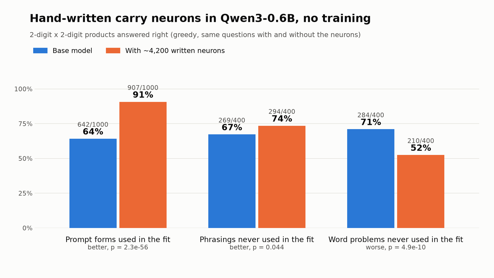
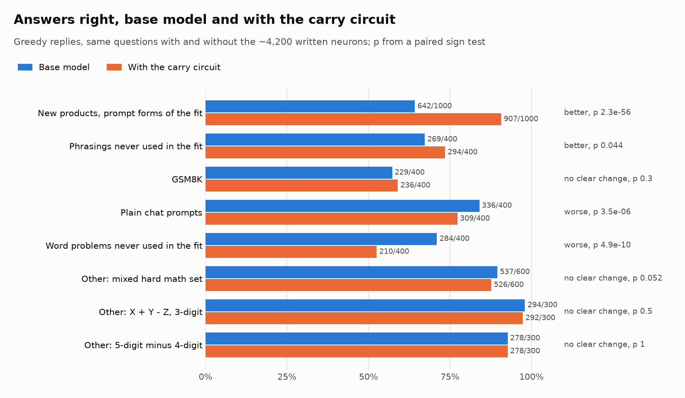
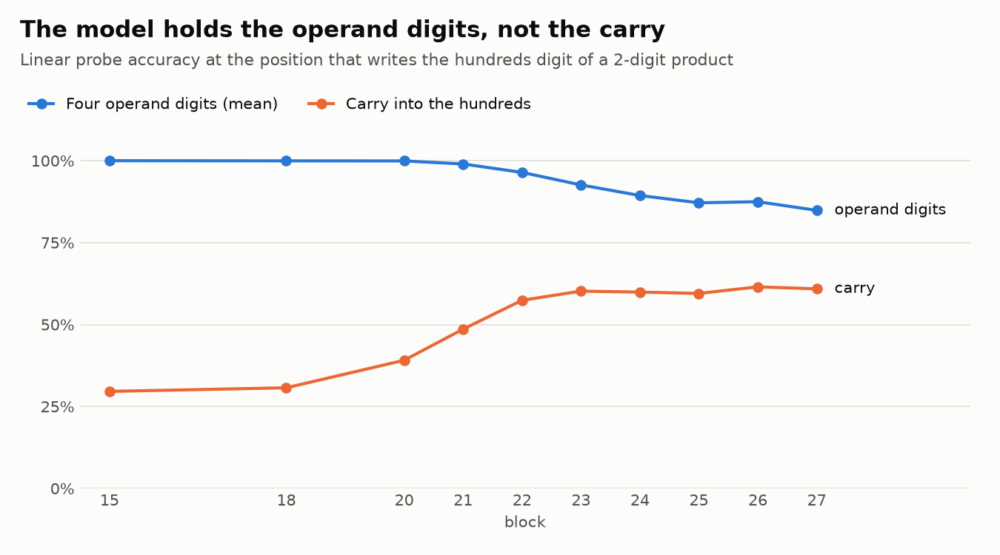
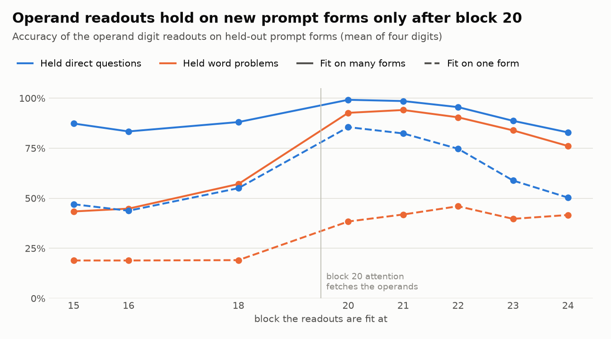
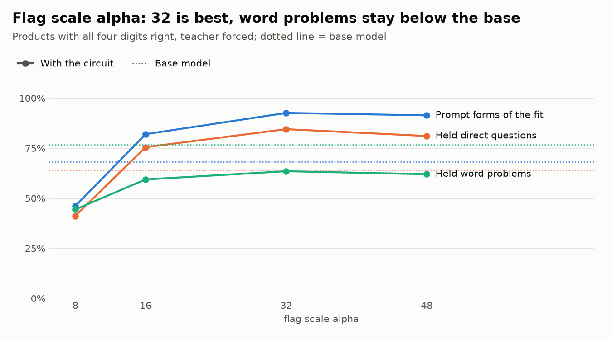

# qwen-surgery

Training-free edits of a small open LLM, Qwen3-0.6B, on Apple silicon with
MLX. Each edit is written directly into the weights or the forward pass: no
run trains the model. Each edit is then measured on math tasks, on other
tasks and on plain text.

The full record of every experiment, with numbers and the files that hold
them, is in [NOTES.md](NOTES.md).

## Main results

- Hand-written neurons compute a missing step of the model's arithmetic
  (sections 27 and 28). The model holds the four operand digits of a
  two-digit product, but not the carry. About 4200 new MLP neurons, with
  weights written from the school method, compute the hundreds and tens
  digit. Only linear readouts are fitted (closed-form ridge, no gradient).
  - On new products in the prompt form of the fit: 642 to 907 right of
    1000 (paired, p = 2e-56).
  - On prompt phrasings never used in the fit: 269 to 294 of 400
    (p = 0.044).
  - Open problem: on word problems the circuit also fires where it cannot
    read the operands, and it loses (284 to 210 of 400).
- The model computes products and sums with a few parts (sections 3 to 16):
  - Block 20 attention fetches the operand digits by place value.
  - Block 21 MLP neurons code a sum digit as waves of periods 10, 5, 3.3,
    2.5 and 2.
  - Blocks 22 and 23 code it one-hot.
- The largest math lever is the reply style, not the arithmetic circuit
  (sections 17 to 23). Scaling one output-head row (the token "To") makes
  the model work step by step. This raises a hard set, but gives no gain on
  GSM8K.

## Charts

`plots.py` draws these charts from the logs in `runs/`
(`uv run --with matplotlib python plots.py`).

The carry circuit against the base model, on the same questions
(`runs/carrymulti_w12_gen.log`). First the three main sets, then all sets:

<picture>
  <source media="(prefers-color-scheme: dark)" srcset="docs/img/summary-dark.png">
  
</picture>

<picture>
  <source media="(prefers-color-scheme: dark)" srcset="docs/img/results-dark.png">
  
</picture>

Why a carry circuit: linear probes read the four operand digits near 100%,
but the carry only at 30 to 61% (`runs/opprobe_mul2x2.log`):

<picture>
  <source media="(prefers-color-scheme: dark)" srcset="docs/img/probe-dark.png">
  
</picture>

Why the circuit sits at blocks 20 to 24: the operand readouts hold on new
prompt forms only after the block 20 attention, and only with a fit on many
prompt forms (`runs/carrygate*.log`):

<picture>
  <source media="(prefers-color-scheme: dark)" srcset="docs/img/gate-dark.png">
  
</picture>

Why the flags have scale 32: the residual stream grows over the blocks, so
weaker flags are lost at block 24 (`runs/carrymulti_a*.log`; this sweep fit
4 word-problem forms, the final circuit fits 12):

<picture>
  <source media="(prefers-color-scheme: dark)" srcset="docs/img/alpha-dark.png">
  
</picture>

## Setup

The code runs on Apple silicon (MLX).

1. Install [uv](https://docs.astral.sh/uv/).
2. Install the environment:

   ```bash
   uv sync
   ```

3. Download the model (Apache-2.0) into `models/`:

   ```bash
   uv run hf download mlx-community/Qwen3-0.6B-bf16 --local-dir models/Qwen3-0.6B-bf16
   ```

4. The data is in `data/` (see [data/README.md](data/README.md) for the
   sources and licenses): 200 SimpleStories test stories as plain text, and
   the GSM8K test set.

## Main scripts

| Script | What it does |
|---|---|
| `surgery.py` | Zero, scale or add heads, neurons and output rows; undo the edits |
| `evalmath.py` | Greedy math evaluation (direct, plain, think and steps prompts) |
| `textcheck.py`, `replycheck.py` | Story loss and chat replies, to check side effects |
| `sweep_skip.py`, `sweep_parts.py`, `neurons.py` | Remove blocks, parts, heads or neurons and measure the effect |
| `circuit.py`, `tuning.py`, `steer.py` | Where the answer digit forms, digit neurons, writing a digit |
| `opprobe.py` | Linear probes for the operand digits and the carry of products |
| `carrydata.py` | Teacher-forced product sequences in many prompt forms |
| `carrygate.py` | Do the circuit's readouts hold on held-out prompt forms |
| `carrybuild.py` | Build the hand-written carry circuit and test it |
| `plots.py` | Draw the README charts from the run logs |

For example, build the carry circuit and score it on 1000 new products, on
held-out prompt forms and on GSM8K:

```bash
uv run python carrybuild.py --gen 1000 --gen-seed 5 --general
```

## Results files

`runs/*.log` holds the printed output of the runs that NOTES.md cites. The
JSON outputs and the agent-run folders (`runs/*.json`, `runs/*/`) are not in
the repository: they are large and they hold local paths.

## License

The code is under the [MIT license](LICENSE). The data in `data/` keeps its
own licenses (MIT, see [data/README.md](data/README.md)). The model is not in
this repository; Qwen3-0.6B is under Apache-2.0.
